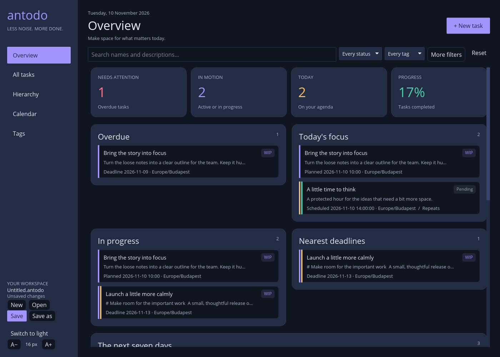

# antodo

**Your tasks, your time, one local file.**

antodo is a Rust desktop TODO application built with [Iced](https://iced.rs/). It combines a daily overview with progress and workload information, task lists, shared-parent outlines, a calendar, and searchable Markdown notes. Each workspace is a portable SQLite database named `something.antodo`. No account or server is needed.



## Project
Project Page:
* https://github.com/tothaa/antodo

Donate András' projects: Say thank you with a tip to the developer. Donations also motivate me to spend more time on Enhancements and Bugfixes.
* 4Fund - https://4fund.com/hu/vhynh2

Alternatives:
* GitHub Sponsors - https://github.com/sponsors/tothaa
* Librepay - https://liberapay.com/tothaa
* ko-fi - https://ko-fi.com/tothaa
* PayPal - https://paypal.me/tothaaprojects

## Run or install locally

Install a current stable Rust toolchain and a C compiler, then run from this directory:

```sh
cargo run --release
```

To install the executable into Cargo's binary directory:

```sh
cargo install --path . --locked
antodo
antodo /path/to/work.antodo
```

Linux needs an X11 or Wayland desktop, system fonts, and a working desktop file portal for native file dialogs. SQLite is bundled; a separate SQLite server or development package is unnecessary. On Ubuntu, the build/desktop prerequisites are typically `build-essential pkg-config libxkbcommon-dev libwayland-dev libx11-dev libxcb1-dev libxkbcommon-x11-dev xdg-desktop-portal` plus the portal backend for your desktop. Desktop launcher and vector icon assets are in [`assets/`](assets/). After installing the executable, run `sh assets/install-desktop.sh` to register the launcher and icon for your user. The Wayland application ID and X11 window class both match `antodo.desktop`; the window also embeds a 128×128 raster of the SVG for platforms that accept window icons. Wayland taskbars resolve the installed desktop entry rather than the embedded bitmap.

The source package is prepared for crates.io, but it has **not been published**. The Iced dependency graph has an unresolved GPL-2.0-only compatibility issue; review and resolve dependency licensing before distributing a combined release. `cargo install antodo` will become available only after the owner creates a crates.io account, confirms the crate name is available, and publishes it. The manifest's `https://github.com/tothaa/antodo` URL is the intended repository; creating or pushing that repository is a separate step. See [release instructions](docs/RELEASING.md).

## Plan your day

- **Overview:** overdue tasks first, current work, today's plans, the next few days, and nearest deadlines. Workload includes status counts, master-task completion, completed/planned effort points, progress by tag, and the five most recent completions. “Won't Do” and “Done” both count as closed in progress and effort reports; status counts remain separate; tasks with several tags appear in each tag's totals.
- **Tasks:** a compact searchable table, initially sorted by name. Click any column heading to sort ascending/descending; use Columns to choose the displayed fields and move them left/right. Rows use status colors with separate stripes for each tag. Hover over any cell to read its full value. Descriptions occupy one truncated line.
- **Outline:** tasks beneath their parents. A task may have several parents; shared references avoid repeatedly expanding the same subtree.
- **Calendar:** scheduled spans with start/end times, planned work and deadline times, and timezones. Choose a display timezone from the searchable list. All-day entries retain their original zone: midnight start and inclusive 23:59 end are converted into the selected zone. Click empty day space to create a task with that day prefilled for start/end. Task cards show their tag colors. Recurring occurrences can be moved, cancelled, restored, or assigned their own status.
- **Notes:** create, edit, delete and search named Markdown notes. Assign existing tags to show their color stripes, and link a note to any number of tasks. Task drawers also offer a Notes assignment section: the same note can belong to several tasks and each task can have several notes. These links share the original note, so editing it updates every reference. Notes have internal UUIDv7 identities and live in the same workspace file. Name/content search is independent of task filters, and unapplied edits use the same apply/discard/stay protection as tasks.
- **Tags:** the form displays the hex color code. Pick color opens a palette/RGB dialog with a live hex preview; Select accepts the color and Cancel leaves the form unchanged.

Right-click a task on Overview, All tasks, Hierarchy or Calendar to edit, change status, plan for today, set priority/severity, toggle tags, add a child, link a parent, link a Note or delete. Hierarchy rows also offer removal from that displayed parent. Shift+click selects multiple tasks; the context menu then shows bulk actions. Bulk edits validate and commit together. **Link a Note** opens the searchable text/tag picker; choosing a note links it to the selected tasks, preserving existing links. The picker hides notes already linked to every selected task and closes after success. Use Save to persist the change.

Drag a Hierarchy row onto another task to replace its displayed parent link. Drop on empty hierarchy space to remove that link. Hold Ctrl (Option on macOS) while dropping to add a parent while keeping existing links; a + indicator marks this mode. A drag includes the selected tasks. If any proposed link creates a cycle or violates completion rules, the whole move is rejected. Other parent links are preserved.

Search names and descriptions on every task view. Filters include status, tag, parent, participant, priority, severity, effort, recurrence/rule text, reminder presence or minutes, notification state, timezone, and date field/range. Light and dark themes and content scaling are remembered between launches.

## LLM chat

Open a workspace and choose **LLM** to configure Ollama, OpenAI API, Gemini API or the local Codex CLI. **Start chat** appears on the main page and in task and note editors, where it carries the selected task or note context. Chat reads applied tasks, Markdown notes, tags and their links. With editing enabled, it can create, update, delete, tag and link notes as well as edit tasks through the same validated core APIs. Changes remain unsaved until Save. The last six completed exchanges are remembered for this workspace session; keys/history are not saved in the workspace or preferences. HTTP providers need `curl`; Codex needs an installed, logged-in CLI. ChatGPT Desktop is supported through the separate external MCP workflow, not an assumed local chat endpoint. See [provider setup, actions and session behavior](docs/LLM.md).

## Files and editing

Create a workspace with **New**, or select **Open**. The last successfully opened or saved file opens at the next launch; an explicit command-line path takes precedence.

**Apply** changes the working document and closes the editor after successful validation. **Save** writes it to disk; **Save as…** chooses another file. The app asks what to do with pending edits before leaving them or closing a dirty file. Failed validation, opens, and saves retain the current work. Saves replace the complete SQLite file atomically, and detect an externally changed destination. Use one editing session per file.

Selecting a task opens its Edit task drawer directly. New tasks and individual occurrence edits also open in a drawer on the right, keeping the current page visible behind them. Use the **Close** button at the drawer's top left, click the dimmed area outside it, or press `Esc` to close it. Unapplied edits still offer apply, discard, or stay choices; closing the drawer keeps your current page and filters.

Task and note drawers share named assignment controls: use the note drawer's **Tags** and **Assigned tasks** sections, or the task drawer's **Notes** section. Each section lists only its assignments. Click a name to open it, **Detach** to remove its link, or **Add…** to open a separate selection dialog. The dialog filters by text and tag; task selection also supports status and priority. Already assigned records are excluded, and several selections can be added before closing. Opening a linked record uses the same unsaved-edit guard and keeps a return chain. Closing, applying or deleting the current linked drawer returns one level to the previous task or note, refreshed with the latest working data. Page/workspace navigation clears the chain. Apply commits content and relationships together; removing a task or tag removes only its note links, while the notes remain available.

The editor includes **Delete** with confirmation. Close offers apply/discard/stay for unapplied edits. Description supports inline colored Markdown highlighting, bold/italic/code styles, and an Editor height slider. Calendar day columns resize with the window. The wider editor keeps Schedule labels beside their date/time controls. Plan for Today fills Planned with today in its selected timezone, applies all edits, and closes only after successful validation.

Keyboard shortcuts: `Ctrl/Cmd+S` saves, `Ctrl/Cmd+Shift+S` saves as, `Ctrl/Cmd+O` opens, and `Ctrl/Cmd+N` adds a task (or a note on Notes).

Tasks, descriptions, relationships, participants, tags, notes, and occurrence overrides are all in the `.antodo` file. Only the last-file path, display theme, and content size are stored separately in the operating system's user configuration directory. There is no background synchronization or autosave. Save before closing to persist reminder acknowledgements as well as your edits.

## Task details and rules

A task has a name; Markdown description; start, end, deadline, planned and completion dates; status; tags; multiple parents; participants; recurrence; reminder; priority; severity; and effort. Priority and severity range from **1 to 5**, both defaulting to **3**, with arrows to increase or decrease either value. Effort is a nonnegative integer. Participants are free-text names or email addresses.

The available statuses are **Pending, WIP, Done, On-Hold, Won't Do, Someday, Event**. Use the colored status buttons in the editor to choose a status, then **Apply changes**. Use **Save** to persist the working document to disk. A task can become Done only when all its children are Done or Won't Do. Reopening a child that would invalidate a completed parent is rejected. Cyclic parent relationships are rejected. Done sets completion to the current local time unless supplied explicitly; leaving Done clears completion.

Use the date/time selector beside a date field to choose a calendar day and optional clock time, or enter `YYYY-MM-DD` or `YYYY-MM-DD HH:MM` directly. The selector is available for task dates, occurrence dates, and date-range filters. Timezone fields sit beside their date fields and offer a searchable dropdown of IANA timezones, such as `Europe/Budapest`, while retaining direct text entry. Each field retains its own timezone, initially the machine's local timezone. Supply both start and end or neither. All-day ends include their final day, and an all-day deadline becomes overdue after that day ends in its timezone. Entered clock-change times that are nonexistent or ambiguous are rejected.


The hierarchy sorts roots and siblings alphabetically, uses compact cards and indented cycling bullets, and marks tasks with multiple parents. In the editor, **Part of → Add** opens a parent picker with search, status, tag and priority filters; **Detach** removes a parent from the draft. Schedule contains dates, recurrence and reminders.

**Close** in the sidebar closes the workspace while keeping antodo running. **Quit** exits. Both protect unsaved work with save/discard/stay choices. Selecting Done fills the editable completion timestamp immediately; Apply preserves a supplied timestamp and defaults an empty one to the current time.

Overview task rows show their deadline beside the name and status, including the shifted deadline of a rescheduled recurring occurrence.

**Event** represents a fixed event. Its editor keeps Start/End, recurrence and reminders, and hides Deadline, Planned, Completed, Effort/points and Plan for Today. Applying Event clears those inapplicable dates and sets effort to zero. Existing version-1 files migrate in memory to version 2 and are updated on disk only when saved.

Large All tasks lists render only the visible rows plus a small buffer. Sorting/filtering results are cached between scroll updates, keeping scrolling work bounded as task counts grow.

## Recurrence and reminders

Enable recurrence and enter a finite [RFC 5545 RRULE](https://www.rfc-editor.org/rfc/rfc5545#section-3.3.10), for example:

```text
FREQ=WEEKLY;BYDAY=MO,WE,FR;COUNT=12
FREQ=MONTHLY;BYDAY=MO,TU,WE,TH,FR;BYSETPOS=-1;COUNT=6
FREQ=DAILY;UNTIL=20261231T225959Z
```

Exactly one ending is required: `COUNT` or `UNTIL`. For date-only tasks use `UNTIL=YYYYMMDD`; timed tasks use a UTC ending ending in `Z`. Recurring start and end must have matching date/time precision, and the start must match the recurrence rule (for example, a Monday start for `BYDAY=MO`). The entire series is limited to 10,000 occurrences; additional rule-complexity limits return an error instead of displaying incomplete results. Generated times follow local clock changes; nonexistent local times are skipped without consuming `COUNT`, and repeated times use the first instant. See [architecture and limits](docs/ARCHITECTURE.md#dates-and-finite-recurrence).

Click a recurring calendar entry to open its Edit task drawer, then choose **Edit occurrence** under Schedule to change an individual occurrence. Moving it also moves its relative planned/deadline markers. Changes to the master start/end or recurrence rule clear prior occurrence overrides; the editor explains this before applying them.

A reminder is a number of minutes before a scheduled start, or before the planned date/deadline when no start exists. It appears inside antodo while the app is running, checked every 20 seconds. Unacknowledged reminders have a 24-hour catch-up window after their scheduled start. Recurring occurrences track acknowledgements independently. Reminders do not run while the application is closed and do not send email.

## Architecture and development

**All business/application logic belongs in `src/core/`; all UI handling belongs in `src/ui/`.** The core builds without Iced. SQLite access uses **generic, parameterized SQL functions against a database connection** in `core::sql`. There is no ORM and no SQL in the UI. This separation is a project requirement, documented in [AGENTS.md](AGENTS.md) and the [architecture guide](docs/ARCHITECTURE.md).

Shared helpers keep calendar interval handling, ordered relationship writes, provider execution, save completion, and repeated UI controls consistent. Refactors retain the existing domain and file-safety checks; regression coverage includes failed save continuations and relationship replacement.

```sh
cargo fmt --check
cargo clippy --all-targets -- -D warnings
cargo test
cargo test --no-default-features
rustup component add llvm-tools-preview
cargo install cargo-llvm-cov --locked
cargo llvm-cov --no-default-features --summary-only
cargo llvm-cov --all-features --summary-only
cargo package --locked
```

When a restricted build environment prevents a system `ccache` wrapper from writing its cache, prefix Cargo commands with `CCACHE_DISABLE=1`.

See the [requirements and verification checklist](docs/REQUIREMENTS.md) for automated test coverage, the native screenshot harness, and the desktop interaction checks that should accompany a release. CI runs compilation, formatting, linting, tests, coverage, and package verification on Linux; it does not prove native rendering or file-portal behavior on every desktop.

Tests also lay out and draw real Iced widgets without a desktop, inspect labels and masked inputs, and simulate clicks across pages, drawers and dialogs. Local mock providers exercise chat cancellation, process cleanup and MCP draft protection. Run `cargo test -- --include-ignored` to include the manual large-table construction benchmark.

The project is mostly generated using LLM; GPT-6 (including Astra) and GPT-6.1 models.

## License

Copyright © 2026 tothaa. Project source is licensed under **GPL-2.0-only**. See [LICENSE](LICENSE).

### MCP server

Open a workspace and select **MCP** in the navigation panel. Set the loopback IP, port (default `8765`; `0` chooses a free port), access token (generated for this app session), and optional editing permission, then select **Start**. **Stop** shuts it down. Closing/replacing the workspace also stops it. Settings are locked while running. Tokens are kept in memory, masked on screen and copied only on request.

The page includes a copyable Codex configuration and connection instructions. This is authenticated, stateless Streamable HTTP at `/mcp`. Read-only tools list/search tasks, fetch complete tasks and list tags; enabling edits adds create/update/delete. Changes use the same core validation and working document as the GUI, appear immediately, and remain unsaved until **Save**. External mutations are rejected while local drawers, edits or dialogs are active. MCP cannot choose files, save files or quit antodo.

See [MCP setup and client examples](docs/MCP.md), based on the [MCP transport specification](https://modelcontextprotocol.io/specification/2025-11-25/basic/transports), [official Codex MCP documentation](https://learn.chatgpt.com/docs/extend/mcp) and [OpenAI Secure MCP Tunnel documentation](https://developers.openai.com/api/docs/guides/secure-mcp-tunnels). ChatGPT/cloud clients require a separately configured private tunnel or authenticated gateway; a localhost URL alone is not reachable from the cloud.
